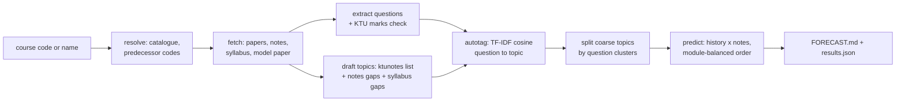

<div align="center">

# KTU Exam Predictor

[](LICENSE)
[](https://www.python.org/)
[](#install)
[](https://www.npmjs.com/package/skills)
[](https://github.com/justhashim/ktu-exam-predictor/actions/workflows/tests.yml)

Tell it your KTU subject. It tells you which topics to study first.

</div>

## Index

**🎓 For students:** plain words, no jargon
- [What it does](#what-it-does)
- [Does it work?](#does-it-work)
- [Install](#install)
- [Use it](#use-it)
- [Use it in web ChatGPT or Gemini](#use-it-in-web-chatgpt-or-gemini)
- [Is it safe?](#is-it-safe)

**🔧 For developers:** how it's built and measured
- [Pipeline](#pipeline)
- [Sources and how each is used](#sources-and-how-each-is-used)
- [Ranking model](#ranking-model)
- [Evaluation](#evaluation)
- [Command line](#command-line)
- [Data files](#data-files)
- [Security design](#security-design)
- [Tests, CI and contributing](#tests-ci-and-contributing)

---

# 🎓 For students

## What it does

You type something like *"predict DAA, exam on 27 Nov"* into an AI coding agent (Claude Code, opencode and others). The skill then:

1. **Collects everything about the subject:** the official syllabus, the module notes, about 10 past question papers (including the older version of the course), and the official model question paper.
2. **Reads every question** from those papers, with its marks.
3. **Works out which topics come up most,** and which take the most space in the notes and syllabus.
4. **Gives you a study plan:** topics in order, module by module, with every past version of each question.
5. **Teaches it,** one topic at a time. Say "next" to move on.

It takes about a minute, and it's free: plain Python, nothing to install from pip, no accounts.

## Does it work?

**How we check it.** Say a subject's syllabus is 10 chapters, and you only have time for 4.
- **With the tool:** you study the 4 chapters it ranks highest.
- **Without it:** you pick 4 chapters at random.

Then we take the **real exam paper** and count how many marks you could have answered each way. The forecast only gets material from **before** the exam: no peeking at the paper it's tested on.

**Strict and lenient.** We count marks two ways, because a question doesn't always match a topic name exactly:
- **Lenient:** a question counts if the topic you studied includes it, even when the topic's name doesn't say so. For example, PPP is explained inside the notes for "Framing", so studying Framing covers a PPP question.
- **Strict:** a question counts only if a topic on the list is clearly about it. If no topic is named for it, it counts as missed, even if it's somewhere in the notes.

Strict is the tougher, safer number. The truth for a careful student is usually in between.

| Real exam (Nov 2026) | Top 40% studied: strict | Top 40%: lenient | Top 60%: strict | Top 60%: lenient |
|---|---|---|---|---|
| **Computer Networks** (PCCST501) | **65%** (random 40%) | **85%** (random 54%) | **83%** (random 56%) | **95%** (random 73%) |
| **Microcontrollers & Embedded Systems** (PCEOT501) | **67%** (random 49%) | **67%** (random 49%) | **90%** (random 68%) | **90%** (random 68%) |
| **Maths for Electrical & Physical Science 3** (GYMAT301) | **67%** (random 46%) | **72%** (random 48%) | **88%** (random 64%) | **93%** (random 67%) |
| **Maths for Computer & Information Science 3** (GAMAT301) | **77%** (random 49%) | **90%** (random 53%) | **90%** (random 66%) | **95%** (random 72%) |

Each cell is the share of the paper's marks you could answer. For PCEOT501 the topics *are* the syllabus items, so every question matched a named topic and strict equals lenient.

In plain words:
- **Studying in the tool's order beat picking topics at random** on all four papers, on both counts: by 18 to 38 points at 40% of the syllabus.
- **Past questions do come back.** On the GYMAT301 paper, two of the long questions were near-copies of earlier GYMAT301 questions.
- **It works even with almost nothing to go on.** PCEOT501 is from a brand-new branch: no notes, no past papers of its own. Because the tool reads the official syllabus, a 20-mark module that no old paper had was still on the list.

> [!WARNING]
> **That's only four real papers, so treat the numbers as rough.** The tool tells you which **topics** matter, not the exact questions. Cover every module, because each one carries the same marks. No forecast replaces studying.

## Install

With the [`skills`](https://www.npmjs.com/package/skills) tool:

```bash
# Claude Code, for all your projects
pnpm dlx skills add justhashim/ktu-exam-predictor -g -a claude-code

# opencode, for all your projects
pnpm dlx skills add justhashim/ktu-exam-predictor -g -a opencode
```

`npx skills add …` and `bunx skills add …` also work.

**You also need:**
- **Python 3.8 or newer.**
- **A PDF reader for the scripts.** This one is strongly recommended; without it, papers download but can't be read:

  ```bash
  sudo apt install poppler-utils     # Debian/Ubuntu
  sudo dnf install poppler-utils     # Fedora
  brew install poppler               # macOS
  ```

## Use it

Just ask your agent in normal words:

```text
predict DAA, exam is on 27 Nov
what are the important topics for PCCST503?
I have the supply exam for computer networks next month, what will come?
```

You get a file called `FORECAST.md` with:
- **a materials report:** how many papers and notes were found, downloaded and read, how many went into the forecast, and why each one left out was skipped (each download is tried up to 3 times). The agent tells you this before the forecast.
- **the study order,** module by module
- **the questions most likely to come back,** with every past wording
- **a sample paper** put together from likely questions (a guess, clearly labelled)
- **warnings,** for example when there are too few papers to trust the ranking

**No notes or papers online for your subject?** That's common for new branches. The agent asks you to drop your own into a folder; phone photos of question papers are fine. If you don't have any, it carries on with what it can find.

Your files go in `~/Documents/Study Materials/<SUBJECT>/` if that folder exists, otherwise in `~/KTU Exams/`.

## Use it in web ChatGPT or Gemini

ChatGPT and Gemini in the browser are chat windows: they can't reach the terminal on your computer, so they can't run the skill's scripts or save files for you. There are still two ways to use it there.

### 1. Let an agent build the forecast, then study it in web chat

Collecting the papers and ranking the topics needs a terminal. Teaching doesn't.

1. Run the skill once in an agent that has a terminal and supports skills (Claude Code, opencode and others). You get a `FORECAST.md` file.
2. Upload that file to a new ChatGPT or Gemini conversation (drag it in, or paste its contents).
3. Ask:

```text
Read this exam forecast, starting with its warnings, and tell me if the
ranking is weak. Then teach it to me module by module in the order it gives.
For each topic: explain it, show every past version of its likely questions
from the file, and work through the numericals. Wait for me to say "next"
before moving on. If the warnings say the ranking is weak, cover every
module evenly instead of trusting the order.
```

The forecast file itself is yours; it stays on your computer until you choose to upload it.

### 2. Have the chatbot do the whole job (no install, no terminal)

Both chatbots read uploaded PDFs, so you can ask one to build the forecast by hand:

1. **Gather the PDFs:** the syllabus, the model paper and about 10 past papers of the course (plus its older version, if it has one) — from syllabus.ktunotes.live, model.ktunotes.live and pyq.ktunotes.live. Photos of papers work as well as PDFs.
2. **Upload them** into a fresh conversation. If you hit the upload limit, split them across two chats.
3. **Paste this prompt** with them:

```text
You are an exam forecast tool for KTU B.Tech. Use only the uploaded
syllabus, notes and past papers — never invent a question.

1. List every question from every past paper with its marks, following the
   exam pattern in the syllabus (2024 scheme: 8 questions × 3 marks plus
   4 questions × 9 marks; older scheme: 10 × 3 marks plus 14-mark questions).
2. For every syllabus topic record: how often it was asked, how recently,
   and how much space the syllabus and notes give it.
3. Rank the topics round-robin across modules (each module carries the same
   marks), then give me:
   - a study order, module by module
   - the questions most likely to come back, with every past wording
   - a sample paper from likely questions, clearly labelled a guess
4. Put warnings at the top for anything you could not read (scans, garbled
   maths) and for how many papers were usable.
```

> [!WARNING]
> **This is not the tested tool.** The numbers in [Does it work?](#does-it-work) were measured with the scripts; a chatbot doing the same job by hand has no such score. Treat its ranking as a rough guide and cover every module — and if you can run the real thing even once, prefer it, especially for maths and scanned papers, which need transcribing rather than guessing.

Uploading sends copies of those files to OpenAI or Google. They are past papers and public syllabus documents, so nothing private is shared.

## Is it safe?

Yes, it was built with that in mind. Papers and notes are written by other people, so the tool treats them as study material only:
- **It never runs anything** found inside them.
- **It only downloads** from the few sites it needs.
- **Anything that looks like a trick aimed at the AI is hidden,** and you're told about it.

---

# 🔧 For developers

The skill is a `SKILL.md` (the agent's playbook) plus five standard-library Python scripts in `scripts/`. The agent runs one command, reads the result, fixes what the status report flags, then teaches.

## Pipeline



`ktu.py prepare` runs every stage. Each stage is also its own subcommand, and every intermediate file is plain JSON that you can edit by hand.

## Sources and how each is used

| Source | Where from | Used for |
|---|---|---|
| **Syllabus** | syllabus.ktunotes.live (course PDF) | Exam pattern (`8x3 + 4x9`, or `8x2 + 4x6` for project-based courses). Topic gaps: syllabus items with TF-IDF cosine below 0.10 to every topic become topics. Matched items are added to their topic's tagging text. Predecessor fit check. Whole topic list when a course has no notes. |
| **Notes** | ktunotes Drive folders | Topic sizes (pages), which drive the prior and the study effort. Notes sections the ktunotes list misses become topics. |
| **Past papers** | pyq.ktunotes.live index (Drive), MBCET index | Question history. Current-course papers weigh 3x for likely questions. |
| **Model paper** | model.ktunotes.live | Added as a current-course paper. Topics it asks get the model-paper prior boost. |
| **Topic list** | topics.ktunotes.live | Curated topics per module, with recurrence as a weight hint. |
| **Student's own files** | `<subject>/notes/`, `<subject>/papers/` | Picked up on every `prepare`. Photos become papers to transcribe. |

**Predecessor fit.** Older-scheme codes are found by name similarity, and a similar name can hide a different subject. Each predecessor is checked two ways:
- **Syllabus match:** the share of its questions with cosine ≥ 0.12 to some syllabus item. Under 0.5 means a misfit.
- **Chip names:** for microprocessor-type courses, the share of chip-naming questions (8085, 8051, STM32, Cortex, …) that name chips absent from the syllabus. 0.6 or more, over at least 8 questions, means a misfit.

A misfit prints a warning, and `--skip-old CODE` drops it for good. On 7 calibration pairs, correct predecessors scored 0.69–0.95 syllabus match. Wrong ones scored 0.10–0.17, or 0.87–0.93 chip mismatch.

## Ranking model

For each topic *t*, `P(t is asked) = α · history(t) + (1 − α) · prior(t)`, with α = 0.25.

- **history:** an L2-regularised logistic regression, trained on rolling windows of past papers. Its features are frequency, recency (decay 0.7 per paper), presence in the last paper, presence in the last paper of the same type (regular or supplementary), intensity and gap. It needs at least 3 papers; below that, α falls to 0.
- **prior:** `min(2.5, sqrt(pages / median pages))`, scaled to the expected number of distinct topics per paper. Topics with no notes pages use a weight hint (ktunotes recurrence, or 1.0 for syllabus items). Model-paper topics get `1 − (1 − p)(1 − 0.3)`.
- **Study order:** round-robin across modules by P, because each 2024-scheme module carries equal marks.
- **Likely questions:** questions are clustered into families (TF-IDF cosine, average linkage at 0.55, at most one question per paper in a family). Each family's chance is scaled so that the expected repeats match the observed reuse rate of recent same-type papers.

## Evaluation

**Metric:** the share of a real paper's marks that are *attainable* after studying the top *k*% of the syllabus, against random topic choice.
- **Syllabus share:** sized by notes pages, not topic count, because counting topics flatters coarse lists.
- **Attainable marks:** Part A, plus the better option of each Part B pair. A question counts only if every topic it is tagged with was studied.
- **Random baseline:** the mean over 300–500 shuffled orders.
- **Tagging:** the real paper's questions are tagged by hand, so mistakes in the automatic tags can't flatter the score. Two tag sets:
  - **lenient:** the topic whose notes pages or past questions hold the content, even if its name doesn't (CN: PPP under Framing, PCM under Modulation; GYMAT301: Maclaurin series under Laurent series)
  - **strict:** only a topic named for the content; otherwise a `NEW_*` tag that no forecast can cover. `score.py --tags strict` uses this set.
- **Freezing:** the forecast uses pre-exam material only. `score.py` scores a real paper against a frozen snapshot of the forecast.

Strict and lenient at 40% / 60% of the syllabus. "Most reachable" is what studying every topic would give:

| Paper | Strict | Lenient | Random (strict / lenient) | Most reachable: strict / lenient |
|---|---|---|---|---|
| CN (PCCST501) | 65% / 83% | 85% / 95% | 40–56% / 54–73% | 83% / 100% |
| PCEOT501 | 67% / 90% | 67% / 90% | 49–68% | 100% |
| GYMAT301 | 67% / 88% | 72% / 93% | 46–64% / 48–67% | 95% / 100% |
| GAMAT301 | 77% / 90% | 90% / 95% | 49–66% / 53–72% | 95% / 100% |

Full lenient curves, current version, Nov 2026 papers:

| Syllabus studied | 20% | 30% | 40% | 50% | 60% | 70% | 80% |
|---|---|---|---|---|---|---|---|
| **CN (PCCST501):** forecast | 50% | 75% | 85% | 95% | 95% | 100% | 100% |
| CN: random | 30% | 42% | 54% | 63% | 73% | 82% | 88% |
| **PCEOT501:** forecast | 35% | 43% | 67% | 73% | 90% | 90% | 95% |
| PCEOT501: random | 26% | 37% | 49% | 59% | 68% | 78% | 87% |
| **GYMAT301:** forecast | 52% | 57% | 72% | 72% | 93% | 100% | 100% |
| GYMAT301: fully automatic | 52% | 52% | 62% | 72% | 93% | 100% | 100% |
| GYMAT301: random | 26% | 38% | 48% | 58% | 67% | 76% | 85% |
| **GAMAT301:** forecast | 47% | 73% | 90% | 95% | 95% | 95% | 100% |
| GAMAT301: fully automatic | 68% | 85% | 90% | 95% | 95% | 95% | 100% |
| GAMAT301: random | 30% | 41% | 53% | 63% | 72% | 82% | 89% |

**Caveats:**
- **n = 4 papers.**
- **CN:** questions were tagged to the topic whose notes pages hold the content. The ktunotes topic list was checked for leakage: no Nov 2026 tags, and none of the paper's distinctive questions.
- **PCEOT501:** no notes, so the topics are syllabus items, with 7 RAT206 papers as history. The syllabus parser was written after this paper was seen, so it isn't a blind result.
- **GYMAT301:** blind. Every forecast was frozen before the paper was opened, and the newest download was the May 2026 paper.
  - The "forecast" row is the skill run as `SKILL.md` directs: the course's own two past papers (Nov 2025, May 2026) were transcribed from page images, because PDF text garbles maths. The flagged older course, MAT102, was left out.
  - The "fully automatic" row skipped that step: it dropped both garbled papers and ranked from MAT102 papers and the model paper.
  - Two Part B questions repeated earlier GYMAT301 questions.
- **GAMAT301:** blind, frozen the same way. There was no older course. The "forecast" row has the Nov 2025 and May 2026 papers and the model paper transcribed. The fully automatic run read this paper's text well enough, so it did as well or better.
  - Strict misses: two general continuous-random-variable questions (find c for a pdf; the mean and variance of 2X − 3). The topic list has named distributions only, with no general "continuous random variable" topic.
  - A random-walk question was covered only because the skill added that topic from the syllabus.
- **The full record** is in `references/lessons.md`.

## Command line

```bash
S=~/.claude/skills/ktu-exam-predictor/scripts

python3 $S/ktu.py prepare "DAA" --label "Nov 2026"      # all stages, about a minute
python3 $S/ktu.py status  "DAA"                         # materials used, weak spots, warnings
python3 $S/ktu.py predict "DAA" --type supplementary    # re-run after edits
python3 $S/ktu.py topics|autotag|split "DAA"            # single stages (--redo / --all)

python3 $S/ktu.py prepare PCEOT501 --name "Microcontrollers and Embedded Systems"   # code not in the catalogue
python3 $S/ktu.py prepare PCEOT501 --notes-from PBECT404                             # borrow a similar course's notes
python3 $S/ktu.py prepare PBCST504 --skip-old CST307                                 # drop a misfit predecessor

python3 $S/extract_questions.py <subject dir> --check   # validate papers.json against the KTU pattern
python3 $S/score.py <frozen snapshot dir> <paper.json>  # score a real paper (--tags strict)
```

`fetch.py` has its own subcommands: `resolve`, `setup`, `search`, `list-notes`, `notes`, `pyqs`, `outline`.

Environment variables:
- `KTU_STUDY_DIR`: where subject folders go. The default is `~/Documents/Study Materials` if it exists, else `~/KTU Exams`.
- `KTU_CACHE_DIR`: index cache, default `~/.cache/ktu-exam-predictor`.
- `KTU_NO_NETWORK=1`: blocks all downloads.

The code needs Python 3.8+ and the standard library only. Optional: `pdftotext`/`pdftoppm` (poppler), or `pypdf`.

## Data files

```text
<study dir>/<SUBJECT>/
├── notes/, papers/      the student's own files (picked up by prepare)
└── predictor/
    ├── subject.json     code, predecessors, skip_old, exam pattern, alpha, course_boost
    ├── topics.json      key -> {name, module, source, notes pages, weight_hint, model, syllabus_items, family, covers}
    ├── papers.json      papers[] -> {id, label, type, course, scheme, model, questions[]}
    │                    question: {q: "A1" | "B11a", marks, topics: [keys], text}
    ├── materials.json   every file prepare tried: downloaded or not, tries, text or scan, why it failed
    ├── results.json     everything in FORECAST.md, machine-readable
    ├── FORECAST.md      the forecast, starting with a "Materials used" line and the materials report
    ├── syllabus/        PDF, text, MODULES.md
    ├── model/           model question paper (img/ for scans)
    ├── notes/           notes PDFs, text, OUTLINE.txt
    └── pyq/             past papers, text, EXTRACTION.md
```

Question ids follow the paper. 2024 scheme: `A1`–`A8`, then `B9`–`B16` (two per module). 2019 scheme: `A1`–`A10`, then `B11`–`B20`. Sub-parts are `a`, `b`, `c`.

## Security design

Downloaded text is untrusted, and an LLM agent reads what the skill writes from it. All of it goes through `scripts/safety.py`:
- **`check_url`:** https only. The hosts must be on an allowlist (ktunotes.live, Google Drive and googleusercontent, the MBCET library). User-info URLs and look-alike hosts are rejected. Every redirect is checked too, and downloads are capped at 60 MB. `fetch.get` is the only network call site.
- **`clean_text`:** removes zero-width, bidi-override, Unicode tag and control characters. It uses NFC normalisation, so `n²` survives; NFKC is used only for detection.
- **`looks_like_injection` and `scrub`:** pattern detection for text that addresses an AI agent: overrides of earlier directions, role-play, chat tokens, pipe-to-shell, secret paths. Matching text is withheld before it reaches `papers.json`, `topics.json` or `OUTLINE.txt`. On 1,183 real questions and 31,336 lines of notes it flagged nothing.
- **`md_safe`:** every outside string written to `FORECAST.md` has its images and links flattened, HTML escaped, schemes broken and pipes neutralised.
- **`safe_join`:** outside file names can't escape their folder. Symlinks among the student's files are skipped.

## Tests, CI and contributing

- **141 offline tests in `tests/`.** They cover the safety unit tests, downloads, retries and the materials report, end-to-end injection through every input route, core regressions, and a policy suite for pull requests. The policy suite enforces standard library only, one network call site, `subprocess` only for known tools, no `eval` or `shell=`, URL literals on the allowlist, and no hidden characters, HTML comments, shell commands or unknown links in the docs the agent reads.
- **CI** runs on Python 3.8, 3.12 and 3.14 with a read-only token.
- **`main` is protected by a ruleset:** required checks, linear history, no force pushes, no bypass.
- **Releases** follow semantic versioning (major: something old breaks; minor: new features; patch: fixes only). Each one is listed in [CHANGELOG.md](CHANGELOG.md), and `metadata.version` in `SKILL.md` matches the newest entry.

```bash
python3 -m unittest discover -s tests -v    # about a second, offline
```

See [CONTRIBUTING.md](CONTRIBUTING.md). The most valuable contribution is a real exam result: freeze the forecast before the exam, then score it with `score.py` afterwards.

> [!NOTE]
> This project is not connected to KTU or ktunotes.live. It downloads publicly shared files for personal study. Please respect the sources and their terms of use.
