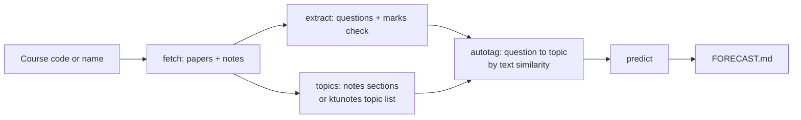

<div align="center">

# KTU Exam Predictor

[](LICENSE)
[](https://www.python.org/)
[](#getting-started)
[](https://www.npmjs.com/package/skills)
[](https://github.com/justhashim/ktu-exam-predictor/actions/workflows/tests.yml)

Give it a KTU course code or name. It finds the past papers and the module notes, works out which topics matter, and turns that into a study plan you can get through before the exam.

[Features](#features) • [Getting started](#getting-started) • [Usage](#usage) • [How it works](#how-it-works) • [Accuracy](#accuracy) • [Safety](#safety-and-contributing)

</div>

An agent skill for students of APJ Abdul Kalam Technological University (KTU). It works with Claude Code, opencode and other agents. Ask your coding agent *"predict DAA"* or *"important topics for machine learning, exam on Monday"* and it will:

1. find the course and its older-scheme versions
2. download about 10 past papers and the module notes
3. build a ranked, module-balanced forecast in about a minute
4. teach it, one topic at a time

## Features

- **Plug and play.** Plain Python 3 standard library, with no `pip install`, no API keys and no setup.
- **One command.** `ktu.py prepare "DAA"` runs the whole pipeline: fetch, extract, topics, tags, forecast.
- **Any course, by code or name.** `PCCST502`, `DAA` and `design and analysis of algorithms` all work. Older-scheme versions are found automatically (PCCST502 → CST306).
- **Topics that cover the current syllabus.** The ktunotes topic list is extended with notes sections it misses. When a course has no notes, the official syllabus is downloaded and each item becomes a topic. Coarse topics are split into subtopics built from groups of similar past questions, and old-course questions that fit nothing go to an "off-syllabus" bucket instead of distorting the ranking.
- **Honest status.** Papers that fail the KTU marks check, scanned papers and low-confidence tags are listed, so you or your agent can see what's worth checking by hand.
- **Module-balanced study order.** Each module carries equal marks, so the plan never leaves a whole module uncovered.
- **Likely questions, with every past wording.** Questions are ranked by reuse, with current-scheme papers weighted higher, and there is an assembled "likely paper".

## Getting started

### Install

With the [`skills`](https://www.npmjs.com/package/skills) CLI. No clone or build needed:

```bash
# Claude Code: for you, in every project
pnpm dlx skills add justhashim/ktu-exam-predictor -g -a claude-code

# opencode: for you, in every project
pnpm dlx skills add justhashim/ktu-exam-predictor -g -a opencode

# only for the current project (any agent; you'll be asked which)
pnpm dlx skills add justhashim/ktu-exam-predictor

# every agent the CLI knows about, no prompts
pnpm dlx skills add justhashim/ktu-exam-predictor -g --all
```

`npx skills add …` and `bunx skills add …` work the same way. To keep it up to date or remove it:

```bash
pnpm dlx skills update ktu-exam-predictor
pnpm dlx skills remove ktu-exam-predictor
```

<details>
<summary>Manual install (git)</summary>

```bash
git clone https://github.com/justhashim/ktu-exam-predictor ~/.claude/skills/ktu-exam-predictor   # Claude Code
git clone https://github.com/justhashim/ktu-exam-predictor ~/.config/opencode/skills/ktu-exam-predictor   # opencode
```

</details>

### Requirements

- Python 3.8 or newer. Nothing to `pip install` for the code itself. On Windows, run `python` or `py` instead of `python3`.
- **Strongly recommended:** a PDF text tool, either `poppler-utils` (`pdftotext`, `pdftoppm`) or `pip install pypdf`.
  - Without one, papers and notes are downloaded but can't be read, so there are no questions to learn from. `ktu.py status` tells you.
  - `pdftoppm` also renders scanned papers as page images that your agent can read.

  ```bash
  sudo apt install poppler-utils     # Debian/Ubuntu
  sudo dnf install poppler-utils     # Fedora
  brew install poppler               # macOS
  ```

Subject folders are created in `$KTU_STUDY_DIR` if set. Otherwise they go in `~/Documents/Study Materials` if that exists, or `~/KTU Exams`.

Optionally, copy `references/student.example.md` to `references/student.md` and fill in your exam calendar and study style. It is git-ignored.

## Usage

### In your agent

```text
predict DAA, exam is on 27 Nov
what are the important topics for PCCST503?
I have the supply exam for computer networks next month, what will come?
```

The agent runs the pipeline, reads the forecast, fixes what the status report flags if there is time, then teaches topic by topic.

### Command line

```bash
S=~/.claude/skills/ktu-exam-predictor/scripts     # wherever the skill was installed

python3 $S/ktu.py prepare "DAA" --label "Nov 2026"    # everything, about a minute
python3 $S/ktu.py status  "DAA"                       # what is worth checking by hand
python3 $S/ktu.py predict "DAA" --type supplementary  # re-run after edits

# a course ktunotes doesn't list (name from the question paper), using a similar course's notes as its syllabus
python3 $S/ktu.py prepare PCEOT501 --name "Microcontrollers and Embedded Systems" --notes-from PBECT404 --notes-from PBCST504
```

Lower-level tools, if you want them:
- `fetch.py`: `resolve`, `setup`, `search`, `list-notes`, `notes`, `pyqs`, `outline`
- `extract_questions.py`: add `--check` to validate edited papers (also marks re-uploaded duplicate papers)
- `ktu.py`: `topics` and `autotag`
- `score.py SNAPSHOT_DIR PAPER.json`: score a real paper against a forecast frozen before the exam

The output is `FORECAST.md` in the subject folder:

```text
<study dir>/<SUBJECT>/
├── notes/           YOUR notes or syllabus, if ktunotes has none (prepare picks them up)
├── papers/          YOUR past papers: one PDF, or one folder of photos, per paper
└── predictor/
    ├── FORECAST.md      study order, likely questions, likely paper
    ├── syllabus/        official syllabus PDF + MODULES.md
    ├── subject.json     course, predecessors, exam pattern
    ├── topics.json      topics with notes pages (auto-drafted, editable)
    ├── papers.json      past questions with marks and topic tags (auto-drafted, editable)
    ├── notes/           notes PDFs + text (img/ for scans)
    └── pyq/             past papers + text, EXTRACTION.md (img/ for scans)
```

## How it works



`predict.py` blends two signals per topic:

| Signal | What it uses | Weight |
|---|---|---|
| History model | Logistic regression on how often and how recently a topic was asked, whether it was in the last paper, and the gap since | 0.25 |
| Notes prior | How many notes pages the topic fills, plus a boost for topics in the official model paper | 0.75 |

Questions are grouped into families of the same question across papers. Each family's chance of returning is scaled so that the expected number of repeats matches the reuse rate seen in past papers of the same exam type (regular or supplementary).

## Accuracy

The first check used KTU's first PCCST501 Computer Networks paper (Nov 2026, 60 marks).
- **Method:** each version re-forecast that paper from pre-exam data only.
- **Measure:** the share of its marks covered by studying the top-ranked part of the syllabus, sized by notes pages.
- **Scoring:** the exam's questions were scored with hand-checked topic tags in every version, so automatic mistakes can't flatter the result.

| Topics and tags | 40% of syllabus studied | 60% of syllabus studied |
|---|---|---|
| **Automatic (`ktu.py prepare`)** | **50%** of marks (random: 35%) | **73%** (random: 49%) |
| Hand-checked | 67% (random: 42%) | 83% (random: 57%) |

What the first check showed:
- **The setter followed the new notes and textbook.** Every question was in the notes, and about half were reworded old-course questions.
- **Topics drawn only from old papers missed new syllabus content** (14 of 60 marks).
- **One automatic method was rejected:** topics from notes headings alone scored no better than random.
- **Measuring by number of topics flatters coarse topic lists,** so this project measures by share of the syllabus.
- **What the measure assumes:** a question counts only if you studied every topic it needs, and you are assumed to master what you study. It's a guide to which topics matter, not a predicted score.

The second check was blind: the forecast was saved before anyone opened the paper. It used PCEOT501 Microcontrollers and Embedded Systems (Nov 2026), which is about as hard a case as the skill gets.
- **It belongs to Electrical and Computer Engineering ("EO" in the code),** a branch new in the 2024 scheme. Its first batch sat this exam, so no past papers exist anywhere.
- **ktunotes doesn't cover the branch yet:** no catalogue entry, notes, topic list or model paper.
- **So the forecast came only from 7 papers of RAT206,** an older course from another branch.

Expect the same for any new branch: no papers until its first exams, and little on ktunotes for a while. The skill now asks for your own notes and papers, and points to similar courses in established branches whose notes can stand in.

| PCEOT501, papers only | 40% of syllabus studied | 60% | Everything in the list |
|---|---|---|---|
| Lenient tags | 58% of marks (random: 40%) | 77% (random: 57%) | 82% |
| Strict tags | 45% (random: 26%) | 57% (random: 38%) | 57% |

- **The ranking still beat random,** by about 18 points.
- **The list could not contain what was new.** A whole ARM module (20 marks) and the 8051 programs and numericals (about 25 marks) never appeared in RAT206 papers.
- **Similar courses would have helped.** The notes of PBECT404 (8051) and PBCST504 (ARM) covered almost all of it, and `setup` now suggests them. Their automatic topics were unusable, though, so build those topics by hand.
- **The official syllabus helped most.** ktunotes' syllabus site had PCEOT501's syllabus, and every question on the paper was in it, ARM module included. With one topic per syllabus item plus the same old papers, studying 40% / 60% of the syllabus covered **67% / 90%** of marks (random: 49% / 68%), on strict tags. The parser was written after seeing this paper, so treat this as encouraging rather than a blind result. `prepare` now fetches the syllabus for every course.

> [!IMPORTANT]
> How well it works depends on the papers. Many KTU papers on ktunotes are scanned with noisy OCR. Their questions are drafted automatically and checked against the KTU marks pattern; scans with no text need transcribing, and `ktu.py status` lists them. Garbled drafts are left out of the forecast, and `FORECAST.md` warns when the data is too thin for the ranking to mean much.

> [!WARNING]
> That's two papers, and some settings were tuned while looking at the first one, so treat the numbers as rough. Predicting the exact wording of a question is weak. The value is in knowing which **topics** to cover, and in covering every module. No forecast replaces studying the notes.

## Safety and contributing

Past papers, notes and ktunotes pages are written by other people, and an AI agent reads what the skill makes from them. So the scripts treat all of it as data:
- **Downloads** are https only, to the ktunotes, Google Drive and MBCET hosts the skill needs, with every redirect checked and a size limit.
- **Text that addresses an AI agent** (prompt injection) is withheld from `papers.json`, `topics.json`, `OUTLINE.txt` and `FORECAST.md`, and `ktu.py status` reports it.
- **Hidden characters are removed, and links, images and HTML are neutralised** in the forecast.
- **File names** from Drive or your own folders can't escape the subject folder.

The test suite checks all of this, plus the rules for pull requests: standard library only, one network call site, no shell, and plain agent-facing docs. It runs offline in about a second:

```bash
python3 -m unittest discover -s tests -v
```

See [CONTRIBUTING.md](CONTRIBUTING.md) before opening a pull request.

> [!NOTE]
> This project is not affiliated with KTU or ktunotes.live. It downloads publicly shared files for personal study. Please respect the sources and their terms of use.
