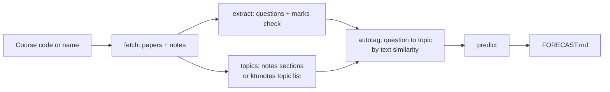

<div align="center">

# KTU Exam Predictor

[](LICENSE)
[](https://www.python.org/)
[](#getting-started)
[](https://www.npmjs.com/package/skills)

Give it a KTU course code or name. It finds the past papers and the module notes, works out which topics matter, and turns that into a study plan you can actually follow.

[Features](#features) • [Getting started](#getting-started) • [Usage](#usage) • [How it works](#how-it-works) • [Accuracy](#accuracy)

</div>

An agent skill for students of APJ Abdul Kalam Technological University (KTU). It works with Claude Code, opencode and other agents. Ask your coding agent *"predict DAA"* or *"important topics for machine learning, exam on Monday"* and it will:

1. find the course and its older-scheme versions
2. download about 10 past papers and the module notes
3. build a ranked, module-balanced forecast in about a minute
4. teach it, one topic at a time

## Features

- **Plug and play.** Plain Python 3 standard library, with no `pip install`, no API keys and no setup.
- **One command.** `ktu.py prepare "DAA"` runs the whole pipeline: fetch, extract, topics, tags, forecast.
- **Any course, by code or name.** `PCCST502`, `DAA` and `design and analysis of algorithms` all work. Older-scheme versions are found automatically (PCCST502 → CST306).
- **Topics that cover the current syllabus.** The ktunotes topic list is extended with notes sections it misses. Coarse topics are split into subtopics built from groups of similar past questions, and old-course questions that fit nothing go to an "off-syllabus" bucket instead of distorting the ranking.
- **Honest status.** Papers that fail the KTU marks check, scanned papers and low-confidence tags are listed, so an agent (or you) knows exactly what is worth checking by hand.
- **Module-balanced study order.** Each module carries equal marks, so the plan never leaves a whole module uncovered.
- **Likely questions, with every past wording.** Questions are ranked by reuse, with current-scheme papers weighted higher, and there is an assembled "likely paper".

## Getting started

### Install

With the [`skills`](https://www.npmjs.com/package/skills) CLI. No clone or build needed:

```bash
# Claude Code: for you, in every project
pnpm dlx skills add justhashim/ktu-exam-predictor -g -a claude-code

# opencode: for you, in every project
pnpm dlx skills add justhashim/ktu-exam-predictor -g -a opencode

# only for the current project (any agent; you'll be asked which)
pnpm dlx skills add justhashim/ktu-exam-predictor

# every agent the CLI knows about, no prompts
pnpm dlx skills add justhashim/ktu-exam-predictor -g --all
```

`npx skills add …` and `bunx skills add …` work the same way. To keep it up to date or remove it:

```bash
pnpm dlx skills update ktu-exam-predictor
pnpm dlx skills remove ktu-exam-predictor
```

<details>
<summary>Manual install (git)</summary>

```bash
git clone https://github.com/justhashim/ktu-exam-predictor ~/.claude/skills/ktu-exam-predictor   # Claude Code
git clone https://github.com/justhashim/ktu-exam-predictor ~/.config/opencode/skills/ktu-exam-predictor   # opencode
```

</details>

### Requirements

- Python 3.8 or newer. Nothing to `pip install`.
- Optional: `poppler-utils` (`pdftotext`, `pdftoppm`) for better PDF text and page images of scanned papers. Without it, the script tries `pypdf` if you have it, and otherwise the agent reads the PDFs itself.

  ```bash
  sudo apt install poppler-utils     # Debian/Ubuntu
  sudo dnf install poppler-utils     # Fedora
  brew install poppler               # macOS
  ```

Subject folders are created in `$KTU_STUDY_DIR` if set. Otherwise they go in `~/Documents/Study Materials` if that exists, or `~/KTU Exams`.

Optionally, copy `references/student.example.md` to `references/student.md` and fill in your exam calendar and study style. It is git-ignored.

## Usage

### In your agent

```text
predict DAA, exam is on 27 Nov
what are the important topics for PCCST503?
I have the supply exam for computer networks next month, what will come?
```

The agent runs the pipeline, reads the forecast, fixes what the status report flags if there is time, then teaches topic by topic.

### Command line

```bash
S=~/.claude/skills/ktu-exam-predictor/scripts     # wherever the skill was installed

python3 $S/ktu.py prepare "DAA" --label "Nov 2026"    # everything, about a minute
python3 $S/ktu.py status  "DAA"                       # what is worth checking by hand
python3 $S/ktu.py predict "DAA" --type supplementary  # re-run after edits
```

Lower-level tools, if you want them:
- `fetch.py`: `resolve`, `setup`, `search`, `list-notes`, `notes`, `pyqs`, `outline`
- `extract_questions.py`: add `--check` to validate edited papers
- `ktu.py`: `topics` and `autotag`

The output is `FORECAST.md` in the subject folder:

```text
<study dir>/<SUBJECT>/predictor/
├── FORECAST.md      study order, likely questions, likely paper
├── subject.json     course, predecessors, exam pattern
├── topics.json      topics with notes pages (auto-drafted, editable)
├── papers.json      past questions with marks and topic tags (auto-drafted, editable)
├── notes/           notes PDFs + text (img/ for scans)
└── pyq/             past papers + text, EXTRACTION.md (img/ for scans)
```

## How it works



`predict.py` blends two signals per topic:

| Signal | What it uses | Weight |
|---|---|---|
| History model | Logistic regression on how often and how recently a topic was asked, whether it was in the last paper, and the gap since | 0.25 |
| Notes prior | How many notes pages the topic fills, plus a boost for topics in the official model paper | 0.75 |

Questions are grouped into families of the same question across papers. Each family's chance of returning is calibrated to the reuse rate seen in past papers of the same exam type (regular or supplementary).

## Accuracy

Checked on one real paper: KTU's first PCCST501 Computer Networks paper (Nov 2026, 60 marks).
- **Method:** each version re-forecast that paper from pre-exam data only.
- **Measure:** the share of its marks covered by studying the top-ranked part of the syllabus, sized by notes pages.
- **Scoring:** the exam's questions were scored with hand-checked topic tags in every version, so automatic mistakes can't flatter the result.

| Topics and tags | 40% of syllabus studied | 60% of syllabus studied |
|---|---|---|
| **Automatic (`ktu.py prepare`)** | **50%** of marks (random: 35%) | **73%** (random: 49%) |
| Hand-checked | 67% (random: 42%) | 83% (random: 57%) |

What the checks showed:
- **The setter followed the new notes and textbook.** Every question was in the notes, and about half were reworded old-course questions.
- **Topics drawn only from old papers missed new syllabus content** (14 of 60 marks).
- **One automatic method was rejected:** topics from notes headings alone scored no better than random.
- **Measuring by number of topics flatters coarse topic lists,** so this project measures by share of the syllabus.

> [!WARNING]
> This is one paper, and some settings were chosen while looking at it, so treat the numbers as rough. Predicting the exact wording of a question is weak. The value is in knowing which **topics** to cover, and in covering every module. No forecast replaces studying the notes.

> [!NOTE]
> This project is not affiliated with KTU or ktunotes.live. It downloads publicly shared files for personal study. Please respect the sources and their terms of use.
