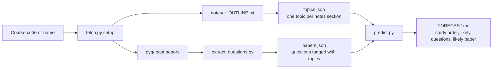

<div align="center">

# KTU Exam Predictor

[](LICENSE)
[](https://www.python.org/)
[](https://docs.claude.com/en/docs/claude-code/skills)

Give it a KTU course code or name. It finds the past papers and the module notes, works out which topics matter, and turns that into a study plan you can actually follow.

[Features](#features) • [How it works](#how-it-works) • [Getting started](#getting-started) • [Usage](#usage) • [Accuracy](#accuracy)

</div>

A [Claude Code](https://docs.claude.com/en/docs/claude-code/overview) skill for students of APJ Abdul Kalam Technological University (KTU). Ask Claude Code something like *"predict DAA"* or *"important topics for machine learning, exam on Monday"* and it will:

1. find the course and its older-scheme versions
2. download about 10 past papers and the module notes
3. extract every question
4. rank the topics with a model that was checked against a real exam paper
5. teach the results, one topic at a time

The scripts also run on their own, without Claude.

## Features

- **Any course, by code or name.** `PCCST502`, `DAA` and `design and analysis of algorithms` all resolve to the same course. Older-scheme versions are found automatically (PCCST502 → CST306).
- **One-step fetch.** Downloads the most recent distinct exam papers and the typed notes from [ktunotes.live](https://ktunotes.live). Scanned papers and notes are rendered to page images.
- **Question drafting and validation.** Drafts `A1`, `B11a`, … with marks from noisy OCR, detects the same exam saved twice, and checks every paper against the KTU marks pattern (`--check`). Broken pages get flagged instead of silently trusted. Claude finishes the flagged papers.
- **Notes-first forecasting.** Topics come from the sections of the current notes and are blended with past-paper history. This fixes the biggest weakness of past-paper-only prediction (see [Accuracy](#accuracy)).
- **Module-balanced study order.** Each module carries equal marks, so the plan never leaves a whole module uncovered.
- **Likely questions, with every past wording.** Questions are ranked by reuse, with current-scheme papers weighted higher. There is also an assembled "likely paper".
- **Quick mode.** With 3 days or less to the exam, teaching starts from the notes immediately while the full forecast finishes in the background.

## How it works



`predict.py` combines two signals:

| Signal | What it uses | Weight |
|---|---|---|
| History model | Logistic regression on how often and how recently each topic was asked, whether it was in the last paper, and the gap since | 0.25 |
| Notes prior | How many notes pages each topic fills, plus a boost for topics in the official model paper | 0.75 |

Questions are grouped into "families" of the same question asked in different papers (TF-IDF similarity with average-linkage clustering). Each family's chance of returning is calibrated to the reuse rate observed in past papers of the same exam type (regular or supplementary).

## Getting started

### Prerequisites

- [Claude Code](https://docs.claude.com/en/docs/claude-code/overview), to use it as a skill
- Python 3.10+ with `numpy`
- `poppler-utils` (`pdftotext`, `pdftoppm`)

```bash
# Debian/Ubuntu
sudo apt install poppler-utils && pip install numpy
# Fedora
sudo dnf install poppler-utils python3-numpy
# macOS
brew install poppler && pip install numpy
```

### Install

Clone it into your Claude Code skills folder:

```bash
git clone https://github.com/justhashim/ktu-exam-predictor ~/.claude/skills/ktu-exam-predictor
```

Optionally, tell the skill about yourself: copy `references/student.example.md` to `references/student.md` and fill it in (your branch, exam calendar, how you like to study). This file is git-ignored.

Subject data goes in `~/Documents/Study Materials/<SUBJECT>/predictor/` by default. To use another folder:

```bash
export KTU_STUDY_DIR="$HOME/KTU"
```

## Usage

### In Claude Code

Start a session and ask in your own words:

```text
predict DAA, exam is on 27 Nov
what are the important topics for PCCST503?
/ktu-exam-predictor microcontrollers
```

Claude runs the steps below, fixes any papers the extractor flagged, tags the questions with topics, and then walks you through the forecast topic by topic.

### Scripts on their own

```bash
S=~/.claude/skills/ktu-exam-predictor/scripts

python3 $S/fetch.py resolve "machine learning"        # which course and predecessors it finds
python3 $S/fetch.py setup "machine learning" --papers 10
python3 $S/extract_questions.py ~/Documents/"Study Materials"/ML/predictor          # drafts; see pyq/EXTRACTION.md
# fix the papers marked review/SCANNED in papers.json, then validate:
python3 $S/extract_questions.py ~/Documents/"Study Materials"/ML/predictor --check
# write topics.json from notes/OUTLINE.txt and tag each question's topics in papers.json, then:
python3 $S/predict.py ~/Documents/"Study Materials"/ML/predictor --type regular --label "Dec 2026"
```

Other `fetch.py` commands: `list-notes`, `notes`, `pyqs`, `search` and `outline`. Run `python3 $S/fetch.py` with no arguments for help.

### Subject folder

```text
<SUBJECT>/predictor/
├── subject.json     course code, predecessors, exam pattern, model weights
├── topics.json      one topic per notes section: module, notes pages, model-paper flag
├── papers.json      every past paper's questions, tagged with topics
├── notes/           notes PDFs, text, OUTLINE.txt, img/ for scans
├── pyq/             past papers, text, EXTRACTION.md, img/ for scans
└── FORECAST.md      the output
```

> [!TIP]
> After the real exam, add it to `papers.json` with `"course": "<current code>"` and run `predict.py` again. A holdout table re-forecasts that paper from the earlier ones, so you can see how each method would have done.

## Accuracy

The method was checked against a real paper: KTU's first PCCST501 Computer Networks paper (Nov 2026, 60 marks). The table shows the share of marks a student could have written after studying only the top 25 or top 35 forecast topics, re-forecast from pre-exam data only:

| Method | Top 25 topics | Top 35 topics |
|---|---|---|
| Past papers only (the original version) | 73% | 83% |
| Notes prior only | 83% | 90% |
| **Blend, as shipped** | **83%** | **90%** |
| Random topics | 49% | 66% |

What that check showed:
- **The setter worked from the new notes and the textbook.** Every question was in the notes, several as the textbook's own worked examples.
- **About half the questions were reworded old-course questions.**
- **Past-paper-only prediction missed** topics that were new to the syllabus.

> [!IMPORTANT]
> Question extraction is a drafting aid. On real KTU scans, most papers need a short manual or Claude-assisted fix before `--check` passes.

> [!WARNING]
> The weights were tuned on that same single paper, so expect less on new papers. Predicting exact question wording is weak; the value is in knowing which **topics** to cover, and in covering every module. No forecast replaces studying the notes.

> [!NOTE]
> This project is not affiliated with KTU or ktunotes.live. It downloads publicly shared files for personal study. Please respect the sources and their terms of use.
