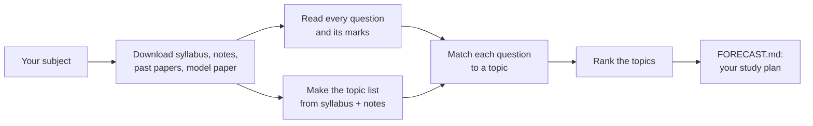

<div align="center">

# KTU Exam Predictor

[](LICENSE)
[](https://www.python.org/)
[](#install)
[](https://www.npmjs.com/package/skills)
[](https://github.com/justhashim/ktu-exam-predictor/actions/workflows/tests.yml)

Tell it your KTU subject. It tells you which topics to study first.

[What it does](#what-it-does) • [Does it work?](#does-it-work) • [Install](#install) • [Use it](#use-it) • [How it works](#how-it-works) • [Safety](#safety)

</div>

## What it does

You type something like *"predict DAA, exam on 27 Nov"* into an AI coding agent (Claude Code, opencode and others). The skill then:

1. **Collects everything about the subject:** the official syllabus, the module notes, about 10 past question papers (including the older version of the course), and the official model question paper.
2. **Reads every question** from those papers, with its marks.
3. **Works out which topics come up most,** and which take the most space in the notes and syllabus.
4. **Gives you a study plan:** topics in order, module by module, with every past version of each question.
5. **Teaches it,** one topic at a time. Say "next" to move on.

It takes about a minute, and it's free: plain Python, nothing to install from pip, no accounts.

## Does it work?

### How we measure it

Say a subject's syllabus is 10 chapters, and you only have time for 4.
- **With the tool:** you study the 4 chapters it ranks highest.
- **Without it:** you pick 4 chapters at random.

Then we take the **real exam paper** and count how many marks you could have answered each way. The forecast only gets material from **before** the exam: no peeking at the paper it's tested on.

### Results

| Real exam (Nov 2026) | Study the top 40% of the syllabus | Study the top 60% |
|---|---|---|
| **Computer Networks** (PCCST501) | **85%** of marks with the tool, 54% at random | **95%** with the tool, 73% at random |
| **Microcontrollers & Embedded Systems** (PCEOT501) | **67%** with the tool, 49% at random | **90%** with the tool, 68% at random |

In plain words:
- **Studying in the tool's order beat picking topics at random** on both papers: by 31 points (Computer Networks) and 18 points (PCEOT501) at 40% of the syllabus.
- **It works even with almost nothing to go on.** PCEOT501 is from a branch that is new in the 2024 scheme: no notes, no past papers of its own, and an older course that never covered ARM. Because the tool reads the official syllabus, the 20-mark ARM module was still on the list.

> [!WARNING]
> **These numbers come from only two real papers. Treat them as rough.** The questions were matched to topics by hand, and the PCEOT501 syllabus reader was built after seeing that paper. The tool tells you which **topics** matter. It can't tell you the exact questions. Cover every module, because each one carries the same marks. No forecast replaces studying.

## Install

With the [`skills`](https://www.npmjs.com/package/skills) tool. Nothing to download by hand:

```bash
# Claude Code, for all your projects
pnpm dlx skills add justhashim/ktu-exam-predictor -g -a claude-code

# opencode, for all your projects
pnpm dlx skills add justhashim/ktu-exam-predictor -g -a opencode

# just this project (it asks which agent)
pnpm dlx skills add justhashim/ktu-exam-predictor
```

`npx skills add …` and `bunx skills add …` also work. To update or remove it later:

```bash
pnpm dlx skills update ktu-exam-predictor
pnpm dlx skills remove ktu-exam-predictor
```

<details>
<summary>Install with git instead</summary>

```bash
git clone https://github.com/justhashim/ktu-exam-predictor ~/.claude/skills/ktu-exam-predictor   # Claude Code
git clone https://github.com/justhashim/ktu-exam-predictor ~/.config/opencode/skills/ktu-exam-predictor   # opencode
```

</details>

**You need:**
- **Python 3.8 or newer.** On Windows, type `python` or `py` instead of `python3`.
- **A PDF reader for the scripts (strongly recommended):** `poppler-utils`, or `pip install pypdf`. Without one, the papers download but can't be read.

  ```bash
  sudo apt install poppler-utils     # Debian/Ubuntu
  sudo dnf install poppler-utils     # Fedora
  brew install poppler               # macOS
  ```

## Use it

Just ask your agent in normal words:

```text
predict DAA, exam is on 27 Nov
what are the important topics for PCCST503?
I have the supply exam for computer networks next month, what will come?
```

You get a file called `FORECAST.md` with:
- **the study order,** module by module
- **the questions most likely to come back,** with every past wording
- **a sample paper** put together from the most likely questions (a guess, clearly labelled)
- **warnings,** for example when there are too few papers to trust the ranking

**If ktunotes has no notes or papers for your subject** (common for new branches), the agent asks you to put your own in a folder. Phone photos of question papers are fine. If you don't have any, it carries on with what it can find.

Your files live in `~/Documents/Study Materials/<SUBJECT>/` if that folder exists, otherwise in `~/KTU Exams/`. Set `KTU_STUDY_DIR` to use another place.

<details>
<summary>Command line, folders and extra options</summary>

```bash
S=~/.claude/skills/ktu-exam-predictor/scripts     # wherever the skill was installed

python3 $S/ktu.py prepare "DAA" --label "Nov 2026"    # everything, about a minute
python3 $S/ktu.py status  "DAA"                       # what is worth checking by hand
python3 $S/ktu.py predict "DAA" --type supplementary  # run again after edits

# a course ktunotes doesn't list: give its name from the question paper
python3 $S/ktu.py prepare PCEOT501 --name "Microcontrollers and Embedded Systems"

# use a similar course's notes when yours has none
python3 $S/ktu.py prepare PCEOT501 --notes-from PBECT404 --notes-from PBCST504

# leave out an "older version" that is really a different subject (remembered)
python3 $S/ktu.py prepare PBCST504 --skip-old CST307
```

Other tools:
- `fetch.py`: `resolve`, `setup`, `search`, `list-notes`, `notes`, `pyqs`, `outline`
- `extract_questions.py --check`: check papers after editing them
- `score.py`: score a real paper against a forecast saved before the exam

What's in a subject folder:

```text
<study dir>/<SUBJECT>/
├── notes/           your own notes or syllabus, if ktunotes has none
├── papers/          your own question papers: one PDF, or one folder of photos, per paper
└── predictor/
    ├── FORECAST.md      the study plan
    ├── syllabus/        official syllabus + MODULES.md
    ├── model/           official model question paper
    ├── notes/           downloaded notes
    ├── pyq/             downloaded past papers
    ├── topics.json      the topic list (you can edit it)
    ├── papers.json      every past question, with marks and topics (you can edit it)
    └── subject.json     course details and exam pattern
```

To save your exam dates and study style for the agent, copy `references/student.example.md` to `references/student.md`. That file stays on your computer.

</details>

## How it works



Each topic gets a score from two things:
- **How big it is in the notes and syllabus.** This counts for 75% of the score. The new syllabus is what the setter follows.
- **How often and how recently it came in past papers.** This counts for 25%. Old papers help, but the syllabus changes.

Topics in the official model paper get a boost.

It also checks its own sources:
- **Every paper's marks must add up** to the KTU pattern. That's 60 marks for most courses, and 40 for project-based ones like Microcontrollers.
- **Each "older version" of a course is checked against the new syllabus.** If its questions don't fit, the tool warns you. For example, an old 8085/8086 course is not a real predecessor of a new ARM course.
- **The forecast starts with a list of what it actually used,** so you can see when something was missing.

<details>
<summary>More detail on the method</summary>

- **History:** a small logistic-regression model on how often a topic was asked, how recently, whether it was in the last paper, and the gap since.
- **Notes and syllabus:** a prior that grows with a topic's notes pages, plus a boost for model-paper topics. The two signals are blended 25% history and 75% notes.
- **Study order:** module-balanced.
- **Likely questions:** the same question across years forms one family. Its chance of coming back is scaled to how often questions repeated in past papers of the same exam type (regular or supply).
- **How accuracy is measured:** as above, by the share of the syllabus studied (sized by notes pages), against random topic choice. A question only counts if you studied every topic it needs, and studying is assumed to work. The full record is in `references/lessons.md`.

</details>

## Safety

Past papers and notes are written by other people, and an AI agent reads what this tool makes from them. So the tool treats all of that text as study material, never as instructions:
- **Downloads** only come from the few sites the tool needs, over https, with a size limit.
- **Text that tries to give orders to an AI** (called "prompt injection") is hidden, and the agent is told about it.
- **Hidden characters, links and images** in downloaded text are removed or made harmless.
- **Downloaded file names** can't write outside the subject folder.

## Contributing

Contributions are welcome. Please read [CONTRIBUTING.md](CONTRIBUTING.md) first. The tests check the safety rules too, and they run offline in about a second:

```bash
python3 -m unittest discover -s tests -v
```

The most useful contribution is a **real exam result**: save the forecast before the exam, then score it after. `SKILL.md` explains how.

> [!NOTE]
> This project is not connected to KTU or ktunotes.live. It downloads publicly shared files for personal study. Please respect the sources and their terms of use.
